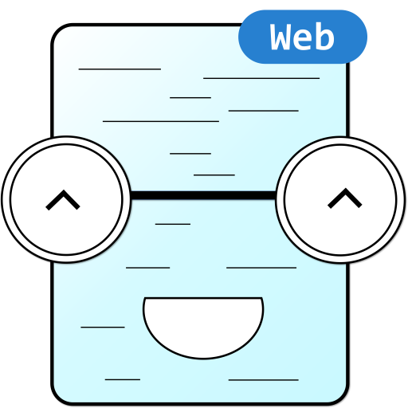

# NoteBot Web V2

All of NoteBot's content is now available on the web!

  

## Features

- [x] 📗 Notes, Lab Reports, Questions
- [x] 🎨 Sleek Animations
- [x] 🌙 Dark Mode Support
- [x] 📱 Responsive Design
- [x] 📱 PWA Support

## Support NoteBot

NoteBot has been free for every BUTEX student since 2018, and it stays that way. If it helped you through an exam, you can help keep it running on [Patreon](https://www.patreon.com/triptex). Support pays for the servers, the bots and app store fees. In Bangladesh? You can support in taka on [SupportKori](https://www.supportkori.com/triptex).
